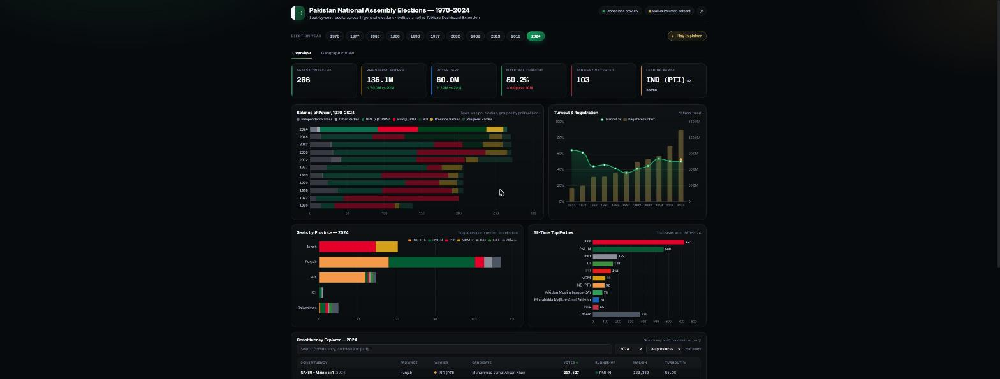
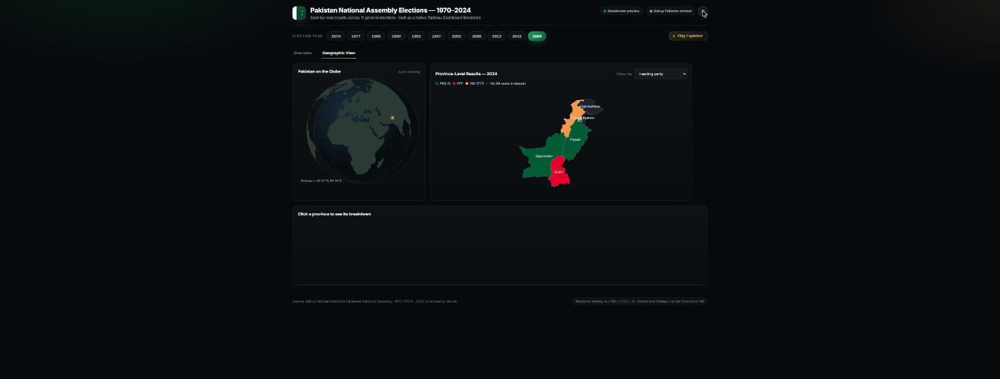
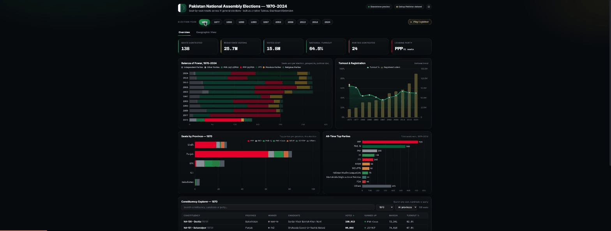

# Pakistan National Assembly Elections 1970–2024 — Tableau Viz Extension

A fully code-based (HTML/CSS/JS) dashboard that runs **inside Tableau** as a **Viz Extension**
and reads its numbers **live** from Tableau's own data source and calculated fields.
No native Tableau charts: ECharts + d3 charts, province map, rotating globe, a guided
"Play Explainer" tour, constituency explorer and a light/dark theme toggle.





## How it works
Tableau worksheet (data source + LOD calcs) → Extensions API `getSummaryDataReaderAsync`
→ `extension/tableau-live.js` reshapes rows → `extension/app.js` renders.
Edit the Tableau data source and the dashboard updates (`SummaryDataChanged` event).
Outside Tableau it falls back to bundled sample data (`extension/data.js`) as a standalone preview.

## Run locally in Tableau Desktop
1. Serve the extension folder:
   ```bash
   cd extension
   python -m http.server 8743
   ```
2. In Tableau Desktop, open a worksheet, Marks card → mark type dropdown → **Add Extension → Access Local Extensions**, and pick `extension/manifest.trex`.
3. Drag the fields (Year, NA, Constituency, Province, District, Division, Party, Six Parties, Candidate Name, Votes, plus the LOD calcs below) onto the **Data** shelf.

### Required calculated fields (FIXED per Year + NA)
Winner Votes, Registered Voters Filled, Seat Votes Total, Is Winner, Winner Party, Second Max Votes, Runner Up Party, Margin, Margin Pct, Turnout Pct.

## Host it for others (Tableau Server / Cloud)
Tableau requires an absolute `https://` URL. Enable **GitHub Pages** for this repo and set the
`<url>` in `extension/manifest.trex` to
`https://<your-user>.github.io/<repo>/extension/index.html`, then add the `.trex` as an extension.
(Tableau Public only allows vetted gallery extensions.) A reference workbook is in `docs/`.

## Data & attribution
Sample data derived from Gallup Pakistan's National Assembly election results (1970–2024).
Used purely for development/demonstration — a technical proof of concept, not a political statement.
Check Gallup Pakistan's terms before redistributing the raw data. Province boundaries: geoBoundaries (public domain);
world map: world-atlas (Natural Earth).
Bundled libraries: Apache ECharts, d3, topojson-client, Tableau Extensions API — see their own licenses.

## License
MIT for the code in this repo (see LICENSE); data and third-party libraries keep their own terms.
